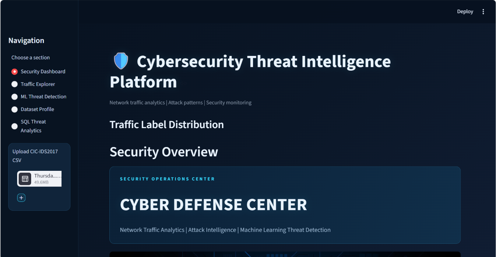
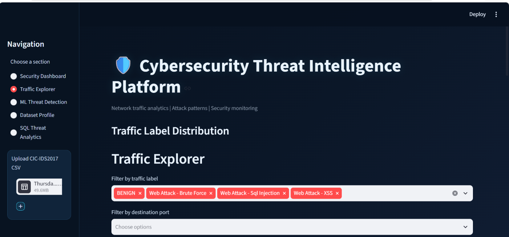
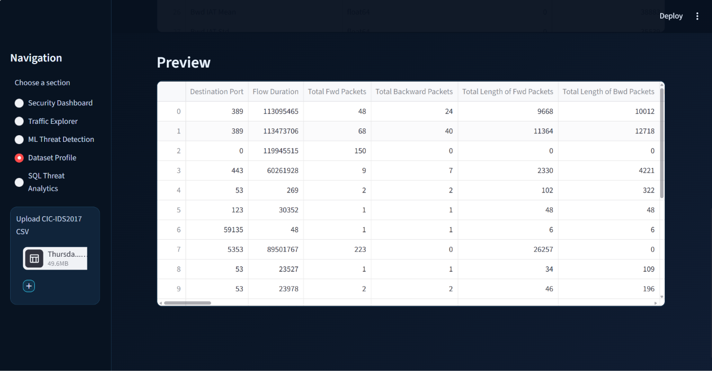
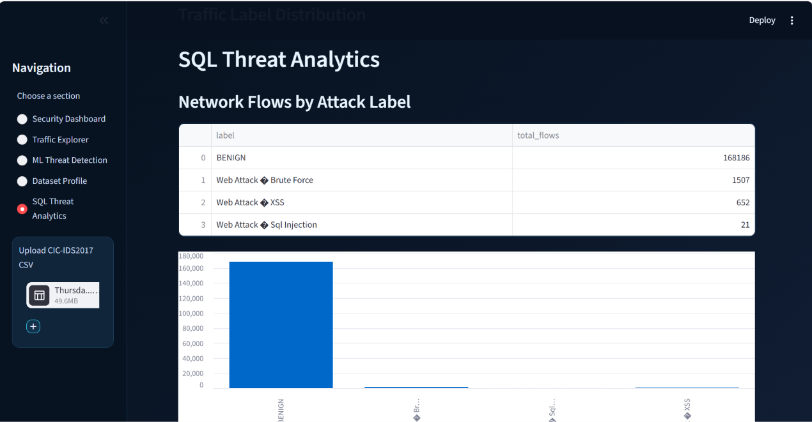
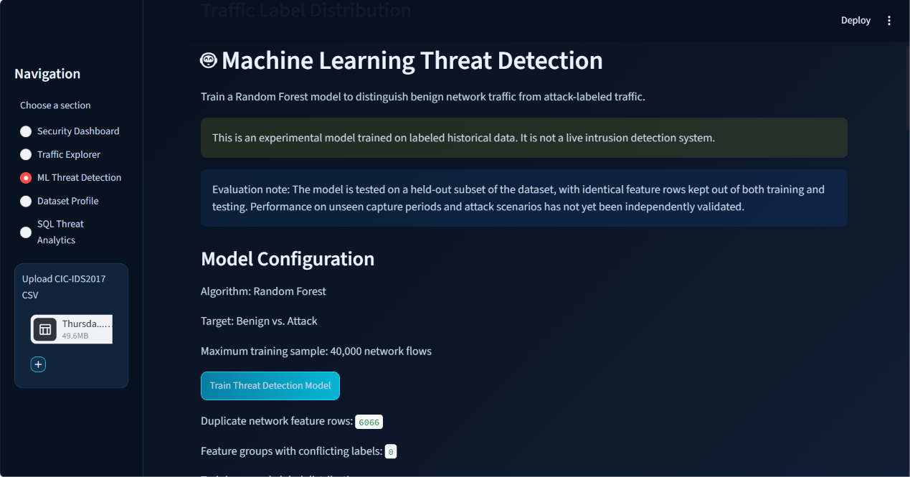
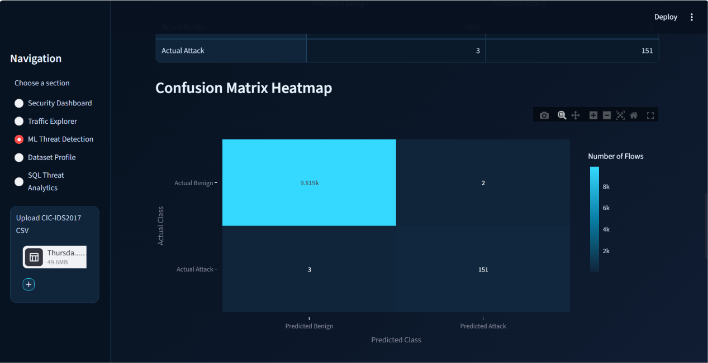

# Cybersecurity Threat Intelligence Platform

An interactive cybersecurity analytics platform built using Python, SQL, Streamlit, and Machine Learning to analyze network traffic, explore attack patterns, and detect potentially malicious activity.

## Project Overview

The Cybersecurity Threat Intelligence Platform analyzes network traffic using the CIC-IDS2017 dataset. It combines data analysis, SQL-based threat intelligence, interactive visualizations, and machine learning to provide insights into network attacks.

## Key Features

- **Security Dashboard:** Visualizes network traffic activity and attack distribution.
- **Traffic Explorer:** Filters network records by attack labels and destination ports.
- **SQL Threat Analytics:** Uses SQLite queries to analyze attack categories, traffic distribution, and malicious network activity.
- **Machine Learning Threat Detection:** Uses a Random Forest classifier to distinguish benign traffic from attack-labeled traffic.
- **Dataset Profiling:** Displays dataset dimensions, missing values, and data previews.
- **Interactive Visualizations:** Uses Plotly and Streamlit for exploring network traffic patterns.

## Technology Stack

| Category | Technologies |
|---|---|
| Programming Language | Python |
| Data Analysis | Pandas, NumPy |
| Database | SQLite |
| Query Language | SQL |
| Machine Learning | Scikit-learn, Random Forest |
| Visualization | Plotly |
| Application Framework | Streamlit |
| Dataset | CIC-IDS2017 |

## Project Structure

```text
cybersecurity-threat-intelligence-platform/
│
├── app/
│   ├── app.py
│   └── cyber_banner.png
│
├── database/
│   ├── setup_database.py
│   ├── run_sql_queries.py
│   └── analysis_queries.sql
│
├── notebooks/
├── reports/
├── screenshots/
│
├── requirements.txt
├── README.md
└── .gitignore
```

## Dataset

This project uses the **CIC-IDS2017 dataset**, published by the Canadian Institute for Cybersecurity.

The dataset contains benign and malicious network traffic, including different attack categories.

Dataset source: [CIC-IDS2017 – Canadian Institute for Cybersecurity](https://www.unb.ca/cic/datasets/ids-2017.html)

**Note:** The dataset and generated SQLite database are not included in this repository. Download the dataset separately before running the application.

## Installation and Setup

### 1. Clone the repository

```bash
git clone https://github.com/Riddhi448/cybersecurity-threat-intelligence-platform.git
```

### 2. Navigate to the project directory

```bash
cd cybersecurity-threat-intelligence-platform
```

### 3. Create a virtual environment

```bash
python -m venv venv
```

Activate it on Windows:

```bash
venv\Scripts\activate
```

### 4. Install dependencies

```bash
pip install -r requirements.txt
```

### 5. Prepare the SQLite database

Download the CIC-IDS2017 CSV dataset.

Run the database setup script:

```bash
python database/setup_database.py
```

When prompted, enter the full path to your downloaded CIC-IDS2017 CSV file.

The script creates a local SQLite database at:

```text
database/cybersecurity.db
```

It imports the CSV data into the `network_traffic` table.

### 6. Run the Streamlit application

```bash
streamlit run app/app.py
```

Open the local URL displayed in your terminal to access the application.

Follow the application's dataset upload instructions when loading data for the dashboard.

## Machine Learning Approach

The platform uses a Random Forest classifier to classify network traffic into two categories:

- Benign traffic
- Attack-labeled traffic

The model is evaluated using standard classification metrics, including:

- Accuracy
- Precision
- Recall
- F1-score
- Confusion Matrix

The model is an experimental analysis tool trained on labeled historical data. Its performance on unseen capture periods and real-world live network traffic has not been established.

## Project Objective

The objective is to demonstrate how data analytics, SQL, interactive dashboards, and machine learning can be combined to support cybersecurity threat analysis and network traffic monitoring.

## Application Screenshots

### 1. Security Dashboard


### 2. Traffic Explorer


### 3. Dataset Profile


### 4. SQL Threat Analytics


### 5. Machine Learning Threat Detection


### 6. Model Evaluation - Confusion Matrix


## Future Enhancements

- Deploy the application for public access.
- Improve model evaluation using independent capture periods.
- Explore real-time network traffic monitoring.
- Add more advanced threat intelligence and reporting capabilities.

---

**Developed as a cybersecurity analytics and machine learning project.**